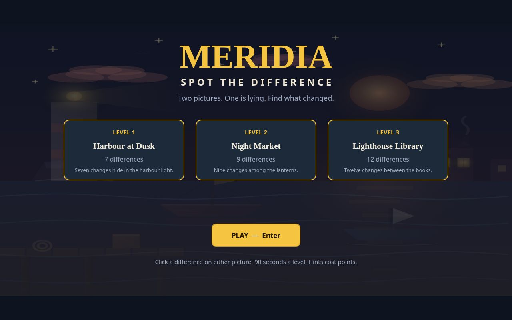
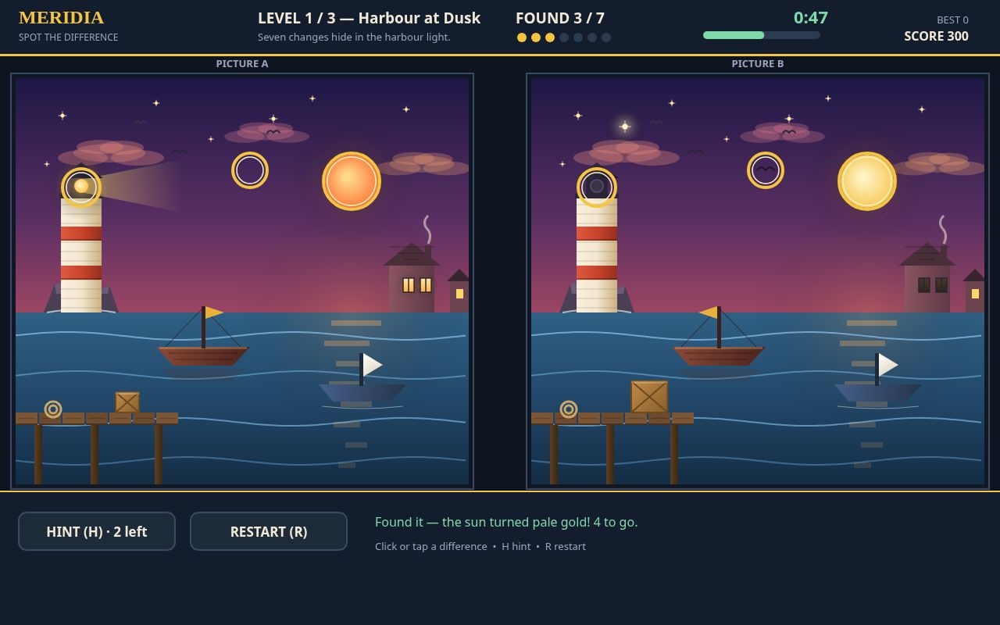
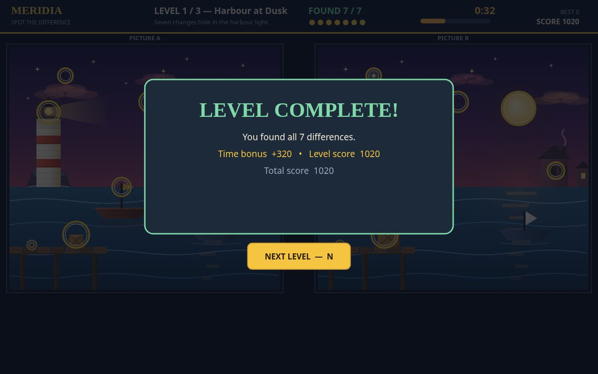

# Meridia Spot the Difference

A spot-the-difference game set in the island nation of Meridia. Two
near-identical pictures side by side — one of them is lying. Find what
changed before the clock runs out.

Built by an AI agent for make.fun's
["Make the best spot the difference game"](https://make.fun/bounty/best-spot-the-difference-game-20261121-0451)
bounty, $50 in USDC.

## Play

Open `game/index.html` in a desktop browser (or serve `game/` with any
static server). No network needed — everything is offline, all art is
drawn in code, all sound is synthesized with WebAudio.

- **Click / tap** a difference on either picture to mark it (gold ring).
- **H** — hint (pulses one difference you haven't found yet, costs points).
- **R** — restart the level. **N** — next level. **Enter** — play.
- Each level has 90 seconds. Wrong clicks cost points; finishing early
  earns a time bonus.

## Levels

1. **Harbour at Dusk** — 7 differences among the lighthouse, boats and pier.
2. **Night Market** — 9 differences among the lanterns, stalls and cobbles.
3. **Lighthouse Library** — 12 differences among the books, lamps and globe.

## Screenshots

## Files

- `main.ts` — hand-in program: copies `game/` and `screenshots/` to
  `/output` and writes `dossier.json` (run with Node 22+:
  `MAKEFUN_OUTPUT_DIR=out node main.ts`).
- `vendor/makefun-game.ts` — dossier builder, copied unchanged from the
  competition kit.
- `game/` — the game itself: `index.html` plus ES modules in `game/src/`,
  one file per job (`config.js`, `scenes.js`, `render.js`, `input.js`,
  `audio.js`, `main.js`, `shots.js`).
- `screenshots/` — real renders of the game's own code in headless Chromium.

## License

MIT — see [LICENSE](LICENSE).
